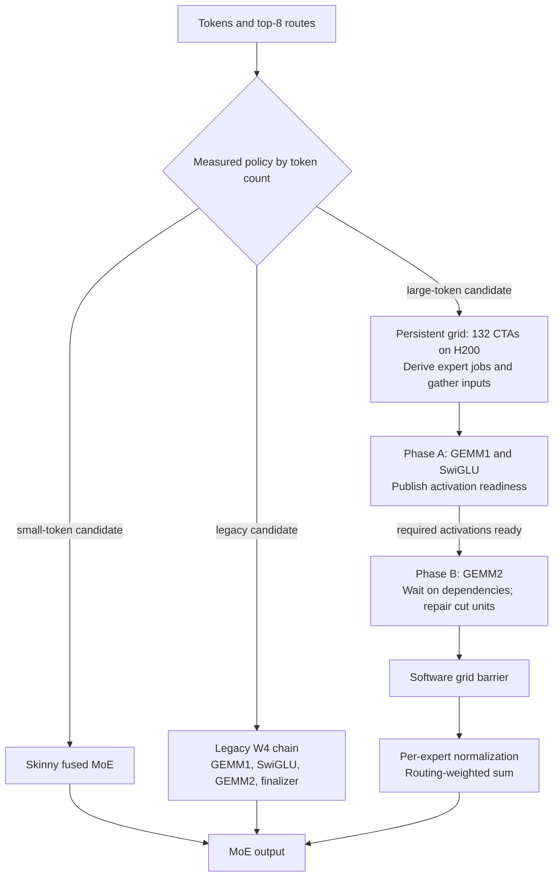
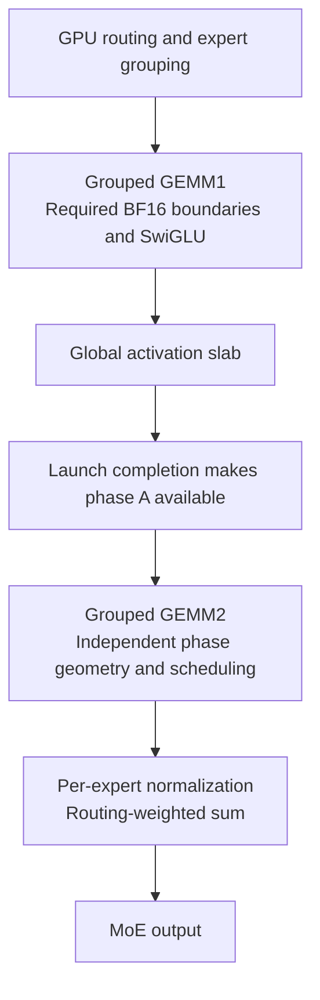
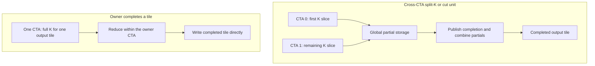
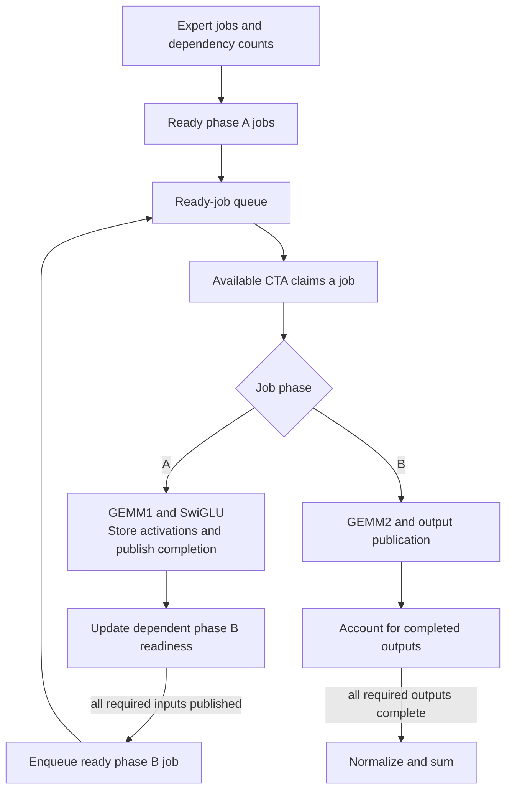
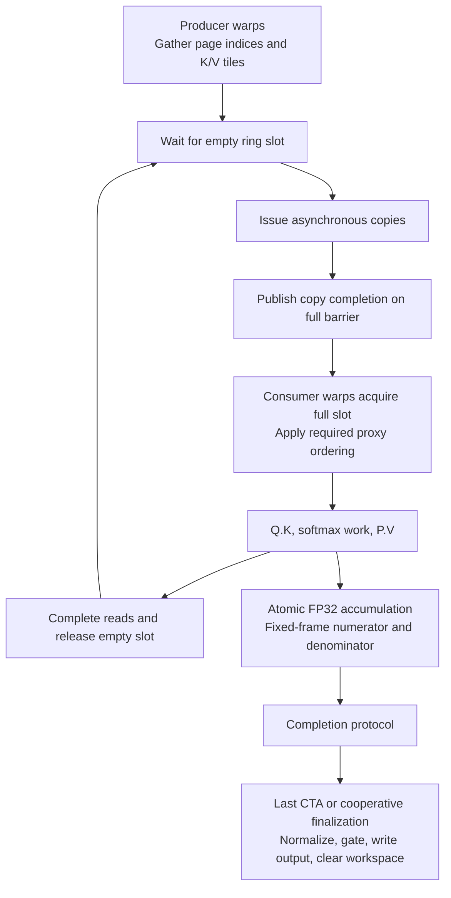
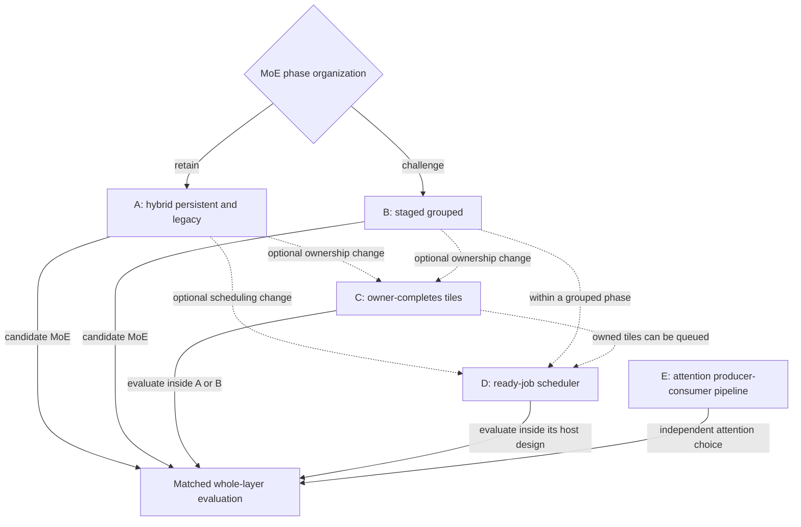

# Architecture families, 2026-10-29

Companion to the [steering plan](plan-2026-10-29-steering.md), preserving the five families
from the [okc research conversation](https://chatgpt.com/c/6ae2a61c-e130-83e8-99a5-aa0567af0482).
Repository evidence below is pinned to `aab7d75`. This document records existing results and
proposals; writing it did not run new GPU benchmarks.

The goal is a faster complete decode layer with the required math and memory ordering.
Launch count, output ownership and scheduling are design choices. The first architectural
comparison is A versus B at **128 and 256 tokens**, where verify-16 and verify-32 process
eight tokens per request. C can improve either MoE family. D changes scheduling. E changes
attention independently of the MoE choice.

## Status at this snapshot

| Family | What changes | Tested versus proposed |
|---|---|---|
| A. Current hybrid | Select skinny persistent, fat persistent or legacy W4 by workload | Tested incumbent. The fenced layer submission is the control; later component checks are separate evidence. |
| B. Staged grouped MoE | Separate phase scheduling through launch boundaries | First challenger in the conversation. The later two-launch prototype passed its GEMM1 gate but lost complete-MoE timing. Other grouped implementations remain proposals requiring a changed mechanism. |
| C. Owner-completes tiles | Give one CTA the full K reduction for an output tile | Phase A ownership is tested in mode 20, retained standalone and selected at 256 tokens in later layer checks. Its isolated layer gain and whole-path ownership remain unproven. |
| D. Ready-job scheduler | Dispatch only work whose dependencies are available | Exploratory. Earlier arithmetic-cost partition models failed; a dependency-aware queue has no result in the cited evidence. |
| E. Attention producer-consumer pipeline | Separate K/V loading from attention compute | Repaired mode 51 is tested standalone and in the layer. Further pipeline changes are speculative; aggregate layer improvement is unresolved. |

A CTA is a CUDA thread block. GEMM1 produces gate/up activations, SwiGLU forms the intermediate
activation, and GEMM2 produces expert outputs. MoE then normalizes each expert output and
applies routing weights in the sum. Every diagram below describes work or dependencies;
the combination diagram instead labels design choices explicitly.

## A. Current hybrid persistent/legacy MoE

The layer keeps a hybrid policy. Small-token shapes have used fused skinny kernels; large
shapes compare the fat persistent kernel with the older W4 chain. The persistent branch is
one launch with 132 resident CTAs on H200. Phase A and phase B are per-CTA work sequences,
so one CTA can enter phase B while another still finishes phase A. The readiness edge is
per dependency, not a whole-grid phase barrier. The global barrier follows phase B.

Fewer launches and overlap between phases are the advantages. Costs include readiness
counters, global cut-unit fixups, shared-memory ring management and the requirement that the
whole persistent grid can make progress. Global activation slabs, output buffers and sums
still exist. One launch does not mean all intermediates stay on-chip.

Tested evidence is in the [MoE port guide](../../docs/moe-port-guide.md) and
[layer run log](../../docs/runs-decode-layer.md). The fenced control is job `a41ace0b94ba4369`,
1.782x with a 95% interval of 1.756-1.811. Earlier layer checks select W4 at 128 tokens
and mode 16 at 256. The [routing probes](../../docs/runs-moe.md#why-the-layer-keeps-the-w4-chain-at-128-tokens-2026-10-29)
show that the tuner's two synthetic seeds favor W4, while six judge-like seeds favor mode 16.
Later layer checks `b9bd3a382ba9449b` and `2fed900548ec4d5b` use a judge-like routing bench
and select mode 16 at 128 and mode 20 at 256. Across their four comparisons with the two
prior mode 51 layer checks, verify-16 step time falls by a mean 25.5 microseconds sliding
and 30.2 full. These are cross-run layer observations supporting the routing diagnosis;
aggregate score intervals still overlap. The hybrid policy retains legacy W4 as a candidate.

## B. Staged grouped MoE

These are logical stages, not a requirement for four launches. The tested prototype combines
routing and GEMM1/SwiGLU in mode 19, then GEMM2 and finalization in mode 21. A grouped phase
may itself use persistent scheduling. The structural change is a launch boundary between the
two GEMMs, replacing their in-launch readiness dependency.

Keep useful compute and layout choices: large expert-token jobs, bulk weight-unit transfers,
exact NVFP4 decoding and the required BF16 rounding points. This challenger can tune each
phase independently and simplify cross-phase readiness. It pays extra boundaries and may
change intermediate traffic or cache reuse. A already stores inter-phase activations globally,
so count actual traffic differences rather than assigning all intermediate storage to B.
Separating phases also removes the overlap between early phase B work and late phase A work.

The [staged gate report](../../docs/runs-moe.md#staged-gemm1-gate-2026-10-29) records the bounded test.
For job `e221858b020c4dee`, means over six matched seeds were:

| Complete MoE, microseconds | 128 tokens | 256 tokens |
|---|---:|---:|
| A, persistent mode 16 | 249.4 | 287.3 |
| B, staged pair 19 then 21 | 277.3 | 311.6 |
| A plus C, mode 20 | 247.3 | 283.5 |
| B minus mode 16 | +27.9 | +24.2 |

Deltas are the logged means of paired differences; rounded column means may differ by 0.1
microsecond when subtracted. The isolated owned GEMM1 beat stream-K GEMM1, but the complete
staged pair lost. The report
attributes the loss to phase overlap available inside the fused launch. This closes the
tested two-launch decomposition at these sizes, as recorded in [ruled-out.md](../../docs/ruled-out.md).
It does not establish a ceiling for every grouped implementation. Reopening B requires a
specific way to offset the measured loss, such as a materially different phase kernel, plus
a new complete-MoE comparison. Merely separating the same work again has already been tested.

## C. Owner-completes output tiles versus split-K fixup

Ownership is per output tile or unit, not per whole expert. One CTA may still use many warps
and divide K internally. The change avoids cross-CTA partial storage and fixup for the owned
tile. The tile remains an intermediate when the rest of the MoE still needs it, and expert
normalization and the routing-weighted sum still follow GEMM2.

The expected benefit is fewer partial writes, completion handoffs and reductions. The risk is
fewer independently schedulable jobs and a longer tail from uneven expert sizes. Estimate tile
parallelism and imbalance on held-out normal and skewed routing before extending ownership to
more phases or small decode workloads. Preserve limited split-K where it pays for parallelism.

A concrete part of C has already worked. Mode 20 assigns each phase A unit to one CTA and
keeps mode 16's phase B and final pass in the same launch. Three same-process comparisons
record mean savings of about 2-3 microseconds at 128 tokens and 4 at 256 over mode 16.
These are standalone paired timings. Mode 20 is retained in the standalone build and the
layer's [inline configuration](../../tools/dl_moe_inline.py) now lists modes 0, 16 and 20.
The two later [layer checks](../../docs/runs-decode-layer.md), `b9bd3a382ba9449b` and `2fed900548ec4d5b`,
select mode 20 at 256 and mode 16 at 128. Verify-32 step changes span roughly -15 to +12
microseconds across runs, so they do not isolate a layer gain from mode 20. See the
[MoE run log](../../docs/runs-moe.md) jobs
`9332e2a49aff4ff2`, `e221858b020c4dee` and `72b7a5a9c511446a`.

C fits inside A or B. The staged prototype and mode 20 share owned phase A units, which lets
us distinguish the benefit of ownership from the cost of separating the launches.

## D. Dependency-aware ready-job scheduler

This is a proposed scheduler, not the current implementation. A mostly precomputed partition
can place a CTA on phase B work whose producers are still busy. A ready-job queue would let
that CTA claim available work instead. The hypothesis is a shorter completion tail and fewer
blocked CTAs.

Costs include queue atomics, contention and less predictable weight streaming. Correctness
requires explicit publication before enqueueing, acquire before consuming, exactly-once job
ownership, safe buffer reuse and termination detection. An empty queue can mean jobs are
still in flight. The scheduler must also prove progress under its residency constraints.

The [cost-model investigation](../../docs/runs-moe.md#cost-model-2026-10-29) tested arithmetic-cost
partitions, not this queue. Better per-CTA cost prediction did not reliably shorten makespan;
the [rejection register](../../docs/ruled-out.md) requires a reopened model to account for phase B waits
on other CTAs. D remains below the simpler ownership and phase-decomposition comparisons.
A bounded test should first establish a dependency-wait cost that useful ready work could
replace, then compare full completion time including queue overhead. Summed CTA wait time is
not recoverable wall-clock time.

## E. Attention producer-consumer pipeline

Producers load future K/V tiles while consumers compute on ready slots. The full/empty ring
protocol controls publication and reuse; increasing buffer depth alone does not guarantee
more overlap. Fixed-frame accumulation removes the need for splits to exchange their running
maximum. Finalization still needs a completion protocol before reading the accumulated rows.
For the full-context verify mode 51 path, finalization is cooperative across the grid.

The repaired producer-warpgroup build is the starting point. Its producer arm uses PTX
`exit` so the compiler keeps the consumer register allocation separate and avoids the spills
seen with the shared `return` path. The [attention port guide](../../docs/attention-port-guide.md)
describes the ring, register split, ordering and workspace invariants; the
[attention run log](../../docs/runs-attention.md) records the repair and standalone checks.

Mode 51 has since reached the layer in checks `69ddb896965d4279` and `6abe9acb0d984d82`.
The [layer log](../../docs/runs-decode-layer.md) records full-verify attention rows about 2-4.5% below
the earlier mode 19 rows. Those are cross-run component observations; the aggregate score
intervals overlap the controls. Further independent producer/consumer progress remains a
hypothesis to test against this repaired baseline. Watch for spills, shared-memory pressure,
ring contention and synchronization cost. Earlier Q.K issue-order and raw-stage refill
experiments in the consumer-copy kernel lost; they do not test every producer pipeline.

## Combinations between families

A plus C is already represented by mode 20 standalone. B plus C is represented by the losing
staged pair, so ownership alone does not justify staging. D could schedule jobs inside A or
within a grouped phase of B; a whole-phase boundary in B already removes the cross-phase
readiness problem, which narrows D's role there. E can accompany either MoE choice. These
combinations do not imply concurrent attention and MoE execution or additive speedups.

## Recommended A-versus-B evaluation at 128/256 tokens

Keep the original two-day limit in the [steering plan](plan-2026-10-29-steering.md).
The first comparison should measure complete MoE, then the layer, while retaining the fenced
incumbent. The later staged-pair result above already supplies the first complete-MoE test.
Use it to decide what a new challenger must change, rather than repeating it unchanged.

1. Freeze source hashes and policy choices. Keep legacy W4 and persistent mode 16 as named
   controls, and include mode 20 to separate ownership from launch organization. Hold attention
   and projection choices fixed during the MoE comparison.
2. Use same-process, same-input paired runs at both 128 and 256 tokens. Repeat across seeds,
   including held-out routing distributions; record local expert counts and imbalance. The
   routing probes show why two synthetic tuner seeds are insufficient to explain the layer.
   Alternate candidate order and state whether cache conditions are cold or representative
   of the actual layer. Include routing metadata consistently or time the complete front.
3. Day 1's GEMM1-only prototype is a diagnostic gate. Compare with phase A measurements, but
   account for instrumentation overhead and the full synchronization/finalization budget.
   A GEMM1-only loss warrants stopping only when the credible savings elsewhere cannot cover
   it. A GEMM1-only win also needs the full-pipeline test, as the staged pair demonstrates.
4. By day 2, measure routing/grouping through expert normalization and weighted sum. Include
   every launch, intermediate write, fixup and finalizer in the elapsed MoE time. Record the
   lost overlap as well as the removed waits. Preserve exact NVFP4 decoding, BF16 boundaries
   and all required publication, async-proxy and reuse ordering. Run correctness and repeated
   graph-replay checks before promoting a candidate.
5. Confirm a surviving candidate on both sliding and full layer shapes at verify-16 and
   verify-32, then check all scored loads for regressions. Use the scoring weight
   `C_load = 46 * t_sliding + 16 * t_full` and the geometric mean of the six load ratios.
   Report paired time differences and uncertainty, not an aggregate component-score sum.

At this snapshot, retain A with the measured routing-policy change and C's mode 20 as a
candidate. The layer now selects mode 16 at 128 and mode 20 at 256. B's tested decomposition
lost by about 24-28 microseconds against mode 16; a new B needs a credible mechanism to recover
that cost. The routing-policy change has supporting verify-16 layer observations, while
mode 20's isolated layer gain remains unresolved. D has no measured win. E has a repaired,
tested implementation, while further pipeline changes and an aggregate layer gain attributable
to attention alone remain open.

## Evidence dependencies

| Claims or decision | Owning evidence at `aab7d75` | Limit |
|---|---|---|
| A's execution, residency and global scratch | [MoE port guide](../../docs/moe-port-guide.md), [kernel source](../../muse_moe_w4a16/submission.py) | The guide's historical unfenced timing table is not used as valid performance evidence here. |
| Fenced layer control and later selections | [Layer log](../../docs/runs-decode-layer.md), jobs `a41ace0b94ba4369`, `69ddb896965d4279`, `6abe9acb0d984d82`, `b9bd3a382ba9449b`, `2fed900548ec4d5b` | Checked configurations and recorded runs, not a newly measured result. |
| Routing explains the tuner discrepancy | [Routing probes](../../docs/runs-moe.md#why-the-layer-keeps-the-w4-chain-at-128-tokens-2026-10-29) | Probe timing is paired; the later layer checks support the routing diagnosis through cross-run observations. |
| B loses; C's phase A ownership helps | [Staged gate](../../docs/runs-moe.md#staged-gemm1-gate-2026-10-29), [raw paired log](../../muse_moe_w4a16/profiles/submission.e221858b020c4dee.log), [repeat log](../../muse_moe_w4a16/profiles/submission.72b7a5a9c511446a.log) | Standalone same-process evidence; later layer checks select mode 20 at 256 but do not isolate its gain. |
| D needs a dependency-aware mechanism | [Cost-model report](../../docs/runs-moe.md#cost-model-2026-10-29), [rejection register](../../docs/ruled-out.md) | Motivation for an experiment, not evidence that queues will win. |
| E's repaired pipeline and layer observations | [Attention guide](../../docs/attention-port-guide.md), [attention log](../../docs/runs-attention.md), [layer log](../../docs/runs-decode-layer.md) | Component improvements do not establish aggregate layer improvement. |
| Evaluation priority and score weights | [Steering plan](plan-2026-10-29-steering.md), [layer task](../../muse_decode_layer/TASK.md) | The plan's historical gap estimates remain cross-run comparisons. |

The recommendation depends on all rows above. If the implementations, measured comparisons
or routing evidence change, revisit the status table, family explanations and recommendation
together. Proposed benefits and costs are hypotheses unless a cited comparison measures them.

## Ongoing performance tracking

See the [hourly performance tracker](../../docs/architecture-performance-tracker.md) for newer family
results, losses, integration status and evidence checkpoints. This guide retains its dated
architecture snapshot.
