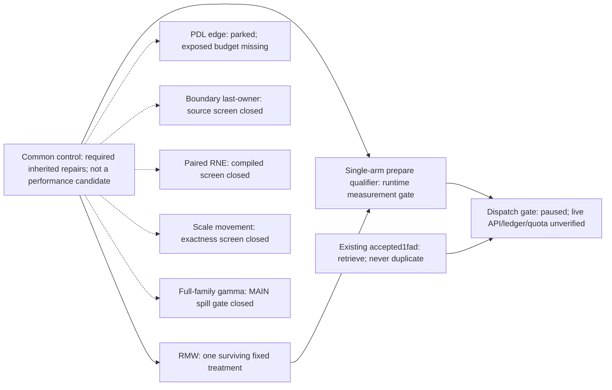

# G candidate funnel and expiring-slot readiness

November1,2026. Root evidence checkpoint `603ed5b081d5c8a2a6be8c04ea7788d51078ab4b`; source rebase `83e54a3`.
New mandatory research principles read from both root instruction files at
`fcc15d5` and updated `852ccce`. This report
continues the user's integration-first priority and later requests to avoid
quota-only delays and develop independent source hypotheses in parallel.
The broad app goal remains paused; source/CPU work is authorized, GPU dispatch
is not resumed. No prefill or unrelated component tuning was started.

**One performance treatment survives the present source screens: short
final-counter RMW.** The common control, source ladder, readers, qualifiers,
and combinations with a closed gamma arm are not additional candidates.
I cannot currently identify a second independent, credible, implemented G
candidate from these bounded investigations. The two other lanes advanced
in parallel and produced specific negative evidence rather than waiting for
the RMW judge result.

The historical G0→607 discrepancy remains **unattributed**. No new GPU
latency, score, CI, exposed stall interval or gap recovery is claimed. The
[minimum-delta audit and ordered plan](2026-11-01-g-minimal-delta-plan.md)
retain exact G0/607 jobs, requirements, conservative choices and all12
historical cells. The new source work below remains in the same FamilyG.

Top10/top50 feasibility is still **unestablished**. The historical G0 score
2.2487905322335195 (own check3a5f879df0d44825) exceeds607's
2.1260826764231093 (own public607eb52bdaf24160) by a1.057715468 ratio,
but those are unmatched observations, not a recoverable budget or distance
to a current cutoff. No fresh cutoff was retrieved during this paused,
service-limited source phase. Historical607 remains the measured incumbent;
the new RMW file is the next measurement candidate, not a promoted best.

The [machine-readable candidate graph](evidence/2026-11-01-g-candidate-funnel/candidate-graph.json)
records exact roles, pins, owners, local gates, closures and unknown outcomes.

## Actual graph and owners

| Lane / owner | Concrete mechanism and code status | Evidence / full-score budget | Next gate and stop |
|---|---|---|---|
| **1: RMW — root + today_moe** | Preserve all writer/proxy fences, CTA relays, acquire, coherent loads, BF16 values and cooperative progress; replace only Tiny/Tiny2 final arrival's acq_rel RMW with proved returning relaxed strong GPU RMW. Fixed rebase and prepare qualifier implemented and locally reviewed. | Prior actual selected compiler removes the atomic-lowering ordering/invalidation block,147regs/3barriers/zero spills unchanged. Root7 qualification facade tests pass. No latency or isolated full-score gain exists. | LOCAL_READY for startup-gated measurement; first actual H200 compile/link/admission/capture/math/budget occurs inside prepare. Dispatch remains paused. Abort on source/proof/actual-path/owner/math/cache/resource/capture/budget failure. No unsafe fence rollback or stalef042 dispatch. |
| **2a: PDL — audit_attention_moe** | One exact edge: cooperative Tiny/Tiny2 primary→ordinary CL1 sliced-unpool secondary. Trigger/prefix/first-read/proxy/lifetime mapped. No OFF implementation emitted. | Primary≥115712B +secondary≥118240B exceeds SM90's233472B shared capacity. Same-SM co-residency excluded; only first-to-last primary retirement skew could hide prefix work. That skew is unmeasured. One unpool call, not eight. | PARKED for missing exposed budget. Reopen with controlled retirement/prefix intervals; do not substitute the full expert/unpool activity or sweep prefetch stages. |
| **2b: changed O-boundary group — audit_attention_moe** | Investigated a last-O-CTA finalizer that materializes every required BF16 edge and FP32 router vector. OldGLE/B1X rewrite remains ineligible. No implementation. | T1 historicalGLE differs; T8 already uses the materialized path. Zeroing all current T1 b1 activity gives conditional1.007345; both shorts1.011831 before any replacement cost. Last-owner work loses existing8CTA/token parallelism. This is an activity-substitution screen, not an exposed-time bound. | CLOSED for this bounded design/budget; no credible≥1% implementation was established. New ownership/parallelism evidence is needed, not reenabling old algebra. |
| **3a: paired BF16 RNE — today_proj** | Actual OFF prototype19cfb4ee/870233B pairs gate/up and down conversions while retaining scale-before-round and all fences. Four selected compiler builds completed. | CPU2tests/524288 rounding-class pairs.12 scalar conversions→6packed conversions adds8PRMT. Tiny non-NOP5230→5233, Tiny25279→5281; gate now waits for UP and PRMT before SiLU. Resources147/3/0spill unchanged. | CLOSED_DEPENDENCY_BUDGET before a runtime harness. No second unpack variant or mask sweep. |
| **3b: changed scaled-output edge — today_proj** | Inspected scale-before-BF16 representation after pairedRNE failed. No second prototype. | Scale multiplication already exists inG0. Actual finite counterexample gives BF16(v*scale)=1.015625 versus BF16(BF16(v)*scale)=1.0078125. No exact dependency removal established. | CLOSED_NO_EXACT_DEPENDENCY_REMOVAL. Do not move the required round or fold scale across it. |

The separate all-family gamma prototype `d6756bb5` remains CLOSED_RESOURCE:
MAIN spills4/32→44/68B in the local compiler screen. Its factorial stays HOLD.
These are scoped source/compiler closures, not new GPU performance losses or
proof that every representation in those families is impossible.

## Source evidence and budget accounting

RMW's fixed source is generated by `tools/g_integration_rmw_release.py` from
exact607, composing the reviewed inherited ATT7/pre-expert changes onto the
pure RMW arm. Both leaf pins remain strict. Exact common-unit reversal and an
independent AST composition prove no hidden gamma/geometry/other-family edit.
Root's two tests pass. Explicit RMW source: **871562B**, SHA256
`2884adb6d0d6947391c81cd67a0c727a04e7d41694d7c780cf8cee80dfa9dbcd`.
The generator's control output is exact common4cbb/871077B. This raw source
arm still requires the prepare qualifier; it is not the old privatef042.
[Source manifest](evidence/2026-11-01-g-candidate-funnel/fixed-rmw-source.manifest.json).

The other lanes' complete evidence is in:

- [Expert→unpool PDL edge](2026-11-01-g-expert-unpool-pdl-edge.md), rootb384ec4/ownerf00cbad.
- [O-boundary alternative](2026-11-01-g-boundary-alternative-closure.md), root1eaf919/ownerf5e252c.
- [Paired RNE source/compiler closure](2026-11-01-g-short-pair-rne.md), root6343c5e/owneraafc32d.
- [Scale boundary feasibility](2026-11-01-g-short-scale-feasibility.md), root2707984/owner917fcca.

Root reran the two actual paired-RNE CPU tests, regenerated both lane2
bounds and the scale counterexample, and verified all16 files in the paired
compiler archive's uncompressed hash ledger. [Root review](evidence/2026-11-01-g-candidate-funnel/root-lane-reviews.json).
The published reports distinguish mathematical/API equivalence, compiler
effects, necessary resource bounds and unknown runtime exposure.

Budget scenarios use the **official layer weighting**, not a microbenchmark
percentage. With historical607 weighted short times78.549045/115.990823us,
holding all other loads/baselines fixed, an equal removed2.753184us in both
contexts of both short loads would give a1% six-load factor;3us gives1.010917.
This is a counterfactual sizing target, not a forecast or a transferred raw
event offset. Actual new-runner inputs, routing, null variability and changed
common-control timing remain unmeasured. None of the closed/parked lanes
demonstrates that removal. Fewer opcodes or profiler totals do not establish
the required exposed time.

The SM90 shared-memory limit is documented by NVIDIA's
[Hopper tuning guide](https://docs.nvidia.com/cuda/hopper-tuning-guide/).
CUDA's paired conversion semantics are supported by the pinned local12.8
headers and the [CUDA math reference](https://docs.nvidia.com/cuda/archive/12.8.1/pdf/CUDA_Math_API.pdf).
Neither source establishes an implementation speedup.

## Expiring scored slots: precise readiness distinction

**Private quota and reset are not prerequisites for an eligible single-arm
measurement.** The user already authorized scored slots as measurements. A
reviewed single-arm candidate may perform fail-closed startup qualification
in `prepare`, then official correctness, then timing. Unknown H200 admission,
capture or setup duration are facts that such a run can establish; requiring
a completed private1% gain check before every measurement would add an
unsupported quota dependency. A public single-arm score still does not
provide a same-input causal A/B price for an integration change.

The [readiness audit](2026-11-01-common-singlearm-startup-requirements.md),
root1a4db1b/owner5e8baee, found a concrete local gap in the bare common source:
its existing56 replay checks cover experts only; attention's self-test is
warmup/guards, and the13 official fuzz tests do not cover all12 scored
geometries. Native attention RuntimeError can be caught and silently delegate
FA3, so a pre-entry hit counter can falsely certify activation. Missing full
model, actual-success, runtime-selection and replay guards are locally
implementable; they are not a reason to wait for private quota.

The new single-arm qualifier is complete for **two separately fixed
files**, common control and the ONE short-RMW treatment. It adds prepare-only actual
ATT7 host selection/checked-launch metadata, successful native-return
observation, independent private G scratch/Lt workspace, all12 model cells,
individually observed changed replay outputs, routing/cache checks, empty/
occupied transitions, actual native resources and a total295s fail-closed
guard. The normal timed kernel/GPU work stays the chosen fixed arm. No
comparison timings or timing-dependent source selection are introduced.

The corrected final source/header/CPU protocol seal is complete:

| Fixed file / role | Bytes / SHA256 | Current readiness |
|---|---|---|
| Common / control |914084 / `4e3895be33d3d8f60670b4e8138eb09654ddc6d64aa930170dc89cc3f019d270`|Locally ready for startup-gated measurement; not an independent performance candidate|
| Common+RMW / treatment |914572 / `97935e7dc45d9fa69f5b4965bd70a5c2946cd8b829cedffb7a2aefc598cb53c7`|Locally ready for startup-gated measurement; NOT H200-qualified|

The treatment is checked in as
[g1b4_common_short_rmw_release.py](../../../muse_decode_layer/cand/g1b4_common_short_rmw_release.py),
with the [ready manifest](../../../muse_decode_layer/profiles/g-common-rmw-ready.2026-11-01/manifest.json).
Root regeneration reproduces the exact physical LF bytes; its Git blob uses
the same pinned bytes. Inherited blank LICENSE comment lines retain their
trailing spaces to preserve the exact reviewed source, rather than silently
changing the upload pin for a cosmetic diff warning.

[Final mechanical handoff verification](evidence/2026-11-01-g-candidate-funnel/root-handoff-verification.json)
also checks all12 generator dependency hashes, the unchanged exact607 blob,
JSON/graph references and local report links. An independent final handoff
review verified the same source/manifest pins and found no material issue.

[Owning implementation](2026-11-01-g-common-singlearm-startup.md), root
43cb483/fe772ed/4de9770 (owners15c3a84/e6c6c34/45a6c82),
[host/header review](2026-11-01-g-common-host-resource-review.md), root
e515134/owner1142844, and [corrected final protocol seal](2026-11-01-common-singlearm-final-review.md),
roota88d6e0/owner000ee51, provide distinct gates. Root independently reran
all7 generated-prepare facade tests: PASS8.050s. They exercise real orchestration
and validators with explicit native/CUDA arithmetic/scheduling stand-ins;
they do not execute the full model on H200. Actual runtime gates are still
unknown and will run before timing in an authorized attempt.

The final native-path report must show12cells,72 model checks,12 captures,
36 individually checked replays,60 empty checks,12 empty captures and48
occupied restores; five native resource keys and actual12 attention dispatch
records are required. Source guards assert the captured compile policy,
including Tiny/Tiny2 RMW flags. The ordinary timed path disables observation
and returns the unchanged production state. DONE alone is insufficient:
one final deadline check follows it, and the owning terminal13/12/12,
flags/errors/setup/source/log gates remain mandatory.

A final review caught a real fallback-owner bug in the earlier bded4957/a12eb0d5
bytes. The actual `_ForkMarlinAdapter` has a cyclic state reference that the
generic cloner correctly rejects. The fix handles nativeFalse **before**
cloning, preserving the exact original adapter/bank/workspace/state and
printing UNEXERCISED/rmw0 with the actual backend status. The seventh test uses
the real extracted class, not a boolean-only surrogate. Old pins are
superseded and must not be uploaded. A legitimate fallback result cannot
establish an RMW effect; require actual native/treatment exercise first.

**No prior separate common-control GPU run is required merely to measure this
fixed RMW arm.** Its own prepare can establish the shared runtime qualification.
This avoids turning the last expiring slot into a two-job/private-quota gate.
A later matched comparison against the common control is still necessary
for causal attribution. The bare871562/4cbb sources and privatef042 remain
incomplete or diagnostic artifacts; use the frozen qualified-source file.

Historicalf042 and the stage/serial-front/four-cell private comparators remain
diagnostic-only/HOLD or deferred. Never consume a scored slot with them.
The closed gamma/paired-RNE arms have failed their local screens. Accepted
`1fad70bbe3854cbc` is already submitted and must never be duplicated.

## Dispatch and stopping decision

Root probes at21:38UTC returned API530; the other coordinator independently
reported the same at13:41Pacific. The latest root status/jobs/quota probes,
22:23:34–49UTC, each reached a15s **local retrieval timeout** with no receipt.
These are not H200 job timeouts, terminal outcomes or proof of quota refunds.
The public website returned HTTP200 from Windows and WSL; that does not
establish authenticated CLI/API health. Accepted1fad outcome and current quota
remain unknown. [Latest status evidence](evidence/2026-11-01-g-candidate-funnel/latest-status.json).
The old preflight had two layer
scored slots before that accepted run; it is not a verified present balance.
The app goal and existing reset automation are PAUSED. No new GPU call,
submission, duplicate job or quota-refund assumption was made in these lanes.

On explicit resume and service recovery, retrieve1fad's own terminal receipt,
logs/profiles and live jobs/quota first. Verify the exact frozen source,
runtime guard/review status and reported migrated runner/baseline identity.
If a useful single arm is locally eligible and a scored slot is available
before16:00Pacific, use the standing authorization rather than waiting solely
for private quota. Prefer the RMW treatment when its complete gates clear;
otherwise a qualified common control can establish the new conforming
reference. No pause or service barrier is bypassed to consume quota.

For causal attribution, a later private comparison still needs matched inputs,
independent duplicates and all12 cells on the same runner. Promotion requires
complete official13/12/12, clean errors/flags and startup evidence plus the
registered full-six/noise/regression gates or explicit user-directed scoped
measurement status. Public point-score changes alone do not explain the old
5.77%. Keep a complete small/inconclusive effect without relabeling it a win.

Stop now on any incomplete source/negative test/header/capture/admission/math/
owner/budget guard, or while explicitly paused or unable to reconcile the API. Do not manufacture breadth
by reopening closed gamma/packing variants, counting controls or declaring
conceptual directions ready. The observation that would broaden this funnel
is new measured exposed overlap/dependency time or a materially different,
proved, compiler-screened G implementation with a defensible full-six budget.
