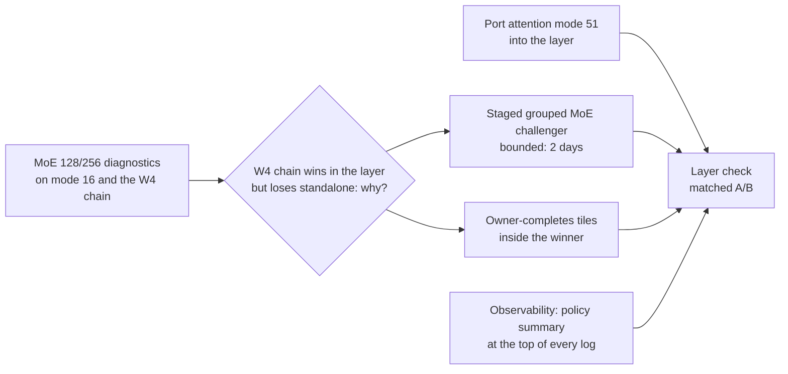

# Steering plan, 2026-10-29

Adopted from the researcher audit of main at 30b2dff. Deadline 2026-11-04 23:59 PT, so about
six scoring days remain.

## Where the gap is

Score math on the valid 1.782x layer submission against the public reference times (cross-run
and historical, so a hypothesis-level map, not a controlled measurement):

| Load | Our weighted load slower by | Share of remaining log gap |
|---|---:|---:|
| decode 1 | 8.9% | 7.7% |
| decode 16 | 9.0% | 7.8% |
| decode 32 | 19.5% | 16.1% |
| verify 1 (8 tokens) | 18.2% | 15.1% |
| verify 16 (128 tokens) | 38.9% | 29.7% |
| verify 32 (256 tokens) | 29.7% | 23.5% |

About 53% of the remaining gap is in the 128 and 256 token loads, and both the sliding and the
full shapes there contain the whole MoE and projection sequence. Saving 20 us on all four of
those shapes would lift the layer score by about 1.6%.

## Order

1. **Freeze the incumbent.** Layer a41ace0b94ba4369 (1.782x) is the control. Stale labels that
   called the withdrawn MoE runs the board entry are annotated (runs-moe.md, plan-2026-10-29.md).
2. **Low-risk integration.** Port attention mode 51 (producer `exit;` fix) into the layer. Mode 16
   MoE is already inlined (e87fcb1ed5c64a62); let the tuner choose, do not force it.
3. **Observability.** Every layer and MoE run prints, near the top of the log where truncation
   cannot drop it: source hash, generated component hashes, selected variant per token bucket,
   failed candidates. The e87fcb1 check lost its MOE1BENCH and MOE1POLICY lines.
4. **Large-token MoE diagnostics.** Measure the repaired mode 16 and the W4 chain at 128 and 256
   tokens: consumer math, epilogue and fixup, dependency waits, completion tail. Report a specific
   removable cost. Do not sum per-CTA barrier waits as if they were end-to-end time.
5. **Staged grouped MoE challenger.** Routing and grouping, then grouped GEMM1 with SwiGLU, then
   grouped GEMM2, then the weighted sum. Keep the new lessons (large expert-token jobs, bulk unit
   transfers, exact NVFP4 decode, one owner per output tile). Budget: a GEMM1-only prototype by
   the end of day 1 compared with phase A stamps; stop if it cannot beat phase A there.
6. **Owner-completes tiles** inside whichever design wins step 5, only if step 4 shows fixups
   are a real share. Ready-work scheduling stays below this.
7. **Bounded secondaries.** The 32-token skinny projection (instruction dependencies, occupancy,
   activation traffic) and one qkv to attention PDL boundary with named independent reads.

## Where I differ from the audit

- **The staged challenger already has a data point.** The layer's tuner picks the old W4 chain,
  which is a staged multi-launch design, at 128 tokens, while mode 16 wins standalone. The
  cheapest decisive test is to find out why the ranking flips inside the layer (L2 state left by
  the projections, overlap with neighbours, or tuner noise). That answer decides whether the
  challenger should be staged at all, so step 4 includes it.
- **Time.** A full grouped-MoE rebuild is a multi-day job with six days left. The GEMM1-only gate
  in step 5 keeps it from eating the week.

## Promotion rule for every experiment

State the bottleneck, the mechanism that changes, why prior negative evidence does not already
reject it (cite the ruled-out row), which scored loads benefit, which correctness obligations
change (writers, publication, observation, async copy, completion, use, reuse), and the
measurement that stops it. Decide on same-process, same-input A/B runs; confirm on the layer.

## Architecture-family diagrams and evaluation

See [Architecture families, 2026-10-29](architecture-families-2026-10-29.md) for the five
Mermaid visualizations, trade-offs, tested versus speculative status, combinations and the
128/256-token A-versus-B evaluation. It includes later staged-pair, ownership and attention
results at `aab7d75`, plus the whole-pipeline qualification to step 5's GEMM1-only gate.
The original plan above is preserved.
