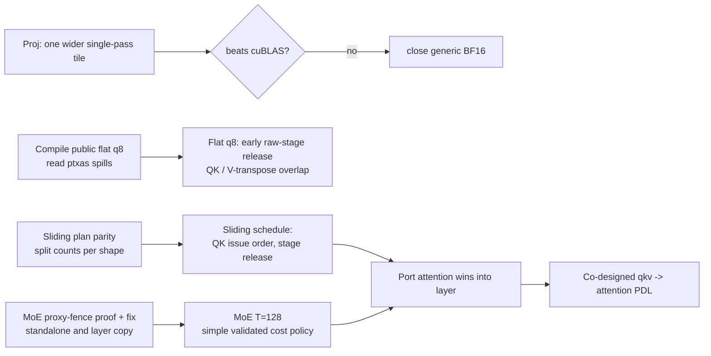

# Plan for 2026-10-29 (from 00:00 UTC reset)

Board at the start: proj 1.400x, MoE 2.009x, attention 2.162x, layer 1.766x; overall rank 277.
Deadline 2026-11-04 23:59 PT. Each problem gets 20 checks and 10 scored runs per UTC day.

## Order and gates

1. **MoE ordering repair first.** A possible missing generic-to-async proxy fence: x tiles written
   with generic stores are read by another CTA through `cp.async.bulk`. Write the full chain
   (all writers -> proxy fence -> scoped release -> acquire -> bulk copy -> completion -> use, and
   when the buffer may be reused) with PTX section citations, fix it in the standalone kernel and
   in the layer's inlined copy, and confirm the layer copy by diff.
2. **Attention, sliding first.** Score math puts about 76% of the log gap to the public times on
   the six sliding shapes and about 10% on full verify b16/b32. Diff launch plans per shape against
   the public ones, then the Q.K issue order and where each stage is released.
3. **Attention, flat q_len 8.** Gate: compile the public flat q8 instance (same toolkit, sm_90a,
   flags) and read its registers and spills. Then test one coherent change with mode 19 as the
   control: release the raw K/V stage after its last raw reader (Q.K done, V transposed) instead
   of after P.V, and overlap the V transpose with Q.K. Keep every proxy fence. Note: W2 already
   reads Q from shared memory; that saving is already spent.
4. **MoE T=128.** No more scored runs on policies chosen by the least-squares stage-cost fit (it
   produced negative coefficients). Replace it with a small model whose terms map to distinct work,
   validated on held-out routing cases against a fixed-cost policy, before it drives the scheduler.
5. **Projections.** One wider single-pass tile test at m = 128/256. If it does not beat cuBLAS by a
   margin that matters to the score, close generic BF16 and keep the wide router.
6. **Layer.** Port attention and MoE wins; then the co-designed qkv -> attention PDL (old K/V and
   page work before `griddepcontrol.wait`, new Q/K/V after).

## Settled, do not redo

- Register handoff (`setmaxnreg` 32 / 104) is already in mode 51; ptxas caps regions at the
  launch-bounds count of 80.
- One-ulp replay differences in attention: consistent with FP32 atomic merge order, pending the
  ordering audit; the 1e-4 stress bound stays.
- Side-stream wide router in the layer lost to the fused concat front.
