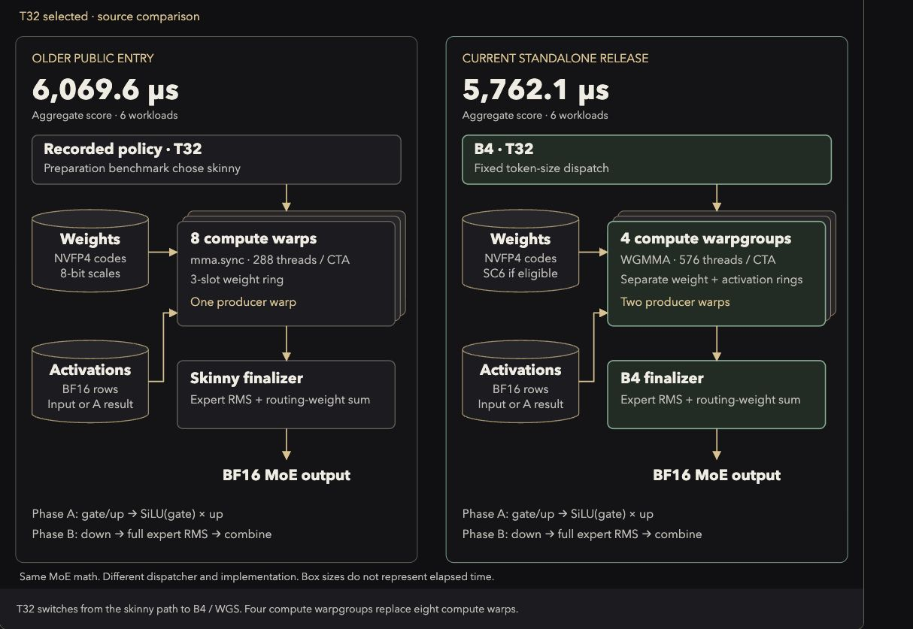

# Faster standalone MoE release diagram

The qualified standalone release measured **5762.134395 us** in private job `64f9998ef238476f`. The public board snapshot checked for this diagram shows **5788.720720 us** for job `4aa033ef23a142cd`, using the same approved source. The comparison separates both points from the older public **6069.607719 us** entry, job `abe7651dbaa44458`.

[Open the interactive comparison](../moe-release-comparison-2026-11-02.html). It matches the existing charcoal-and-gold diagrams, offers six token counts and enlarges each diagram. The standalone SVGs are [source comparison](../figures/moe-release-comparison.svg), [work assignment](../figures/moe-release-work-assignment.svg) and [retained engine](../figures/moe-release-engine.svg).

## What changed

The new standalone release uses the same `c7c201ae` native engine as the earlier layer diagram. The native source, all five compiler requests and all six factory routes match `muse_decode_layer/cand/g1b4_stage_release.py` at `4e6cef5c`. This release brings the existing layer engine into standalone MoE.

The older public comparator resolves to source SHA256 `b35d321730f67b8157eef0683011b118bf3644dc5e9602ee29d823d8056c4e14`, recovered from `ec565a7:muse_moe_w4a16/submission.py`. Its owning receipt selects skinny at T1, T8, T16 and T32, then `main-lean-grp-nohoist` at T128 and T256. The current release selects Tiny, Tiny2, MID, B4 and MAIN by token count, subject to the preserved eligibility/fallback dispatch.

At T32, B4 replaces eight compute warps and one producer warp with four compute warpgroups and two producer warps. CTA size changes from 288 to 576 threads. The new path uses WGMMA and separate weight and activation rings. The small-token routes remain warp-specialized.

At T128 and T256, both implementations already use four compute warpgroups. The older mode47 owns whole phase-A units and dynamically claims whole phase-B units. The current WGS engine assigns cost-weighted stage ranges across both phases. It can split a unit across CTAs, write global partials and use a designated finisher. The work-assignment diagram makes this distinction explicit.

Eligible WGS scales use six-bit storage. The illustrated stage retains 32768 code bytes while scale storage falls from 4096 to 3072 bytes. That is 25% fewer scale bytes and 2.78% less combined stage payload. These are byte counts, not a measured timing contribution. Scale eligibility, PRMT and byte-scale fallback paths remain conditional.

Both implementations retain gate/up projections, SiLU multiplication, down projection, full expert RMS and routing-weight combination. This source comparison does not claim bitwise agreement between different implementations.

## Measurements and limits

The private aggregate score is 5.065786% below the older public point. Those runs use different jobs and inputs. The per-workload table shows complete-call observations, including the small T16 increase from 95.426 to 95.443 us. It does not attribute a saving to dispatch, packing or scheduling separately. The score is an aggregate across six workloads, distinct from the per-call medians shown below the diagrams.

The private speedup is 2.333944174x with CI [2.298935011, 2.368953337]. That interval belongs only to the private job. The public board point has no interval asserted here. The copied private-result record retains its approval state at qualification time; the separate public row records the later public result.

The earlier sparse observer `6028cae5d12f4afb` failed its overall distortion/stability gate and ended on a serialization budget failure. Partial evidence survives, but internal load, decode, WGMMA, wait and phase costs remain unqualified. The diagrams leave those component times unlabelled. See the [owning release and observer report](2026-11-02-moe-control-release-qualification.md).

## Evidence and verification

The exact release file is [current_control_release.py at 4e6cef5c](https://github.com/yelgabo/okc/blob/4e6cef5c/muse_moe_w4a16/cand/current_control_release.py), SHA256 `5df257afd6ae2863bc706826a9798d97b17e73830f1d10703c81bba21203eb9e`. The [private owning receipt](evidence/2026-11-02-moe-release/status-wait.raw.json) supplies its official PASS, five tests, six benchmarks and six profiles. The [older receipt](../../muse_moe_w4a16/profiles/scored.abe7651dbaa44458.json) supplies its selected policy and comparison point. The [public board](https://openkernelchallenge.dev/problems/muse_moe_w4a16) was refreshed during this task; the accepted job's waiter was left with its owner. During publication, origin/main advanced to `5ff38524` with the [completed public receipt](evidence/2026-11-02-moe-public/status-wait.raw.json). Its source, score and PASS counts agree with the captured row. The owner also records a public interval; the diagram continues to label only the private interval.

[Source and result data](evidence/2026-11-02-moe-release-diagram/source-and-results.json) preserve the hashes, six workloads, private interval and public row. [Source checks](evidence/2026-11-02-moe-release-diagram/source-checks.json) record native/build/route identity and the older policy. Source inspection checked the selected scheduler and scale storage paths. No foreign code, GPU job or kernel edit was needed.

[Browser checks](evidence/2026-11-02-moe-release-diagram/browser-checks.json) cover all six selectors, duplicate IDs, enlargement, Escape, restored focus and console errors. Desktop at 1280 px and mobile at 390 px have no page overflow. The diagrams scroll within their own containers on narrow screens. Actual mobile touch panning was not tested. [Mobile capture](evidence/2026-11-02-moe-release-diagram/mobile.png) preserves the layout check. Review was performed in this chat, without an independent reviewer.

Fresh public snapshots and `tools/release_audit.py --check` report zero promotion gaps and 19 private leads against the refreshed public entries. No release ledger or worker assignment changed.

## Next use

Use the T32 view to compare compute organization, and the work-assignment view for T128/T256. Retain the unchanged control for any future internal profile. Component-time overlays require a new observer that passes its registered overhead and stability gates. A failed gate stops attribution. This diagram introduces no experiment or execution assignment.
